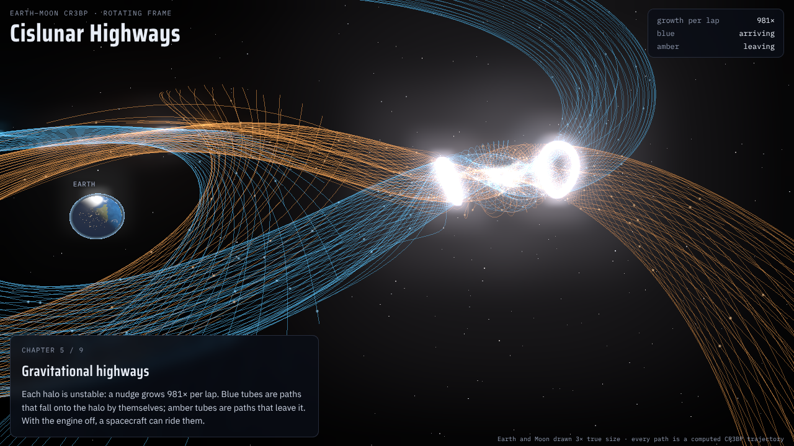
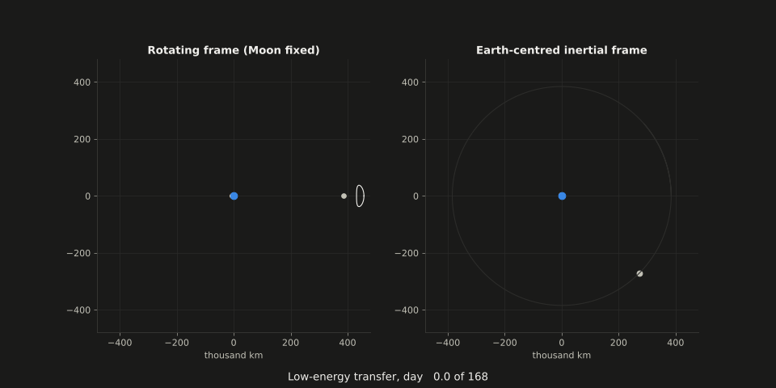
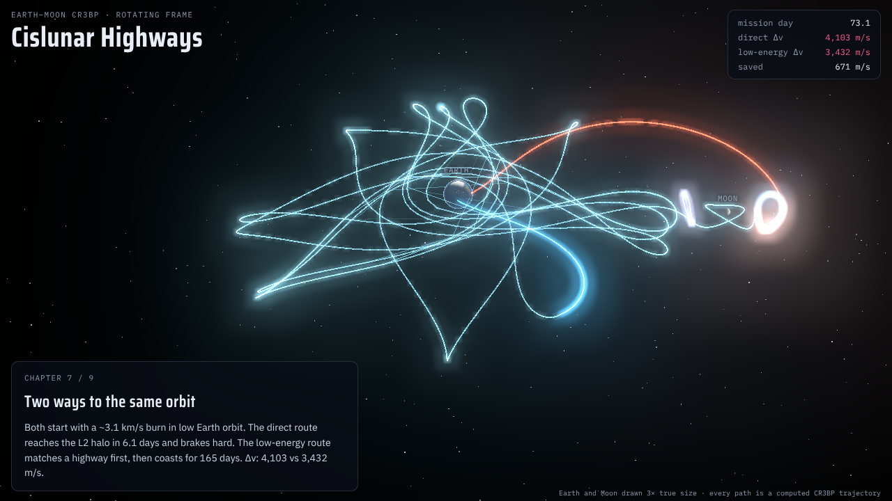
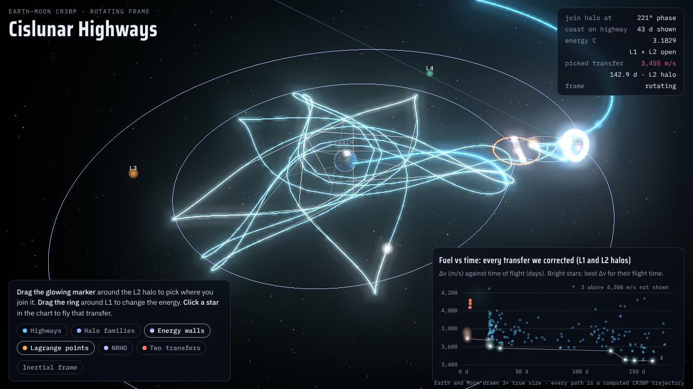

# Cislunar Highways

**Low-energy Earth-to-Moon transfers in the circular restricted three-body problem, built from scratch and checked against independent references.**

*Built in collaboration with [Claude](https://claude.ai), Anthropic's AI assistant. See [credits](#about-and-credits).*

**▶ [Open the interactive 3D explorer](https://USERNAME.github.io/REPO/)** (runs in your browser, nothing to install)
<!-- After enabling GitHub Pages (Settings → Pages → Branch: main, folder: /docs), replace USERNAME/REPO above. -->



### In plain words
Spacecraft don't have to fly straight to the Moon. Between the Earth and the Moon there are invisible "highways": paths along which gravity alone carries a spacecraft onto special orbits near the Moon, with the engine switched off. This project finds those highways mathematically, then uses one to plan a trip from Earth orbit to a lunar orbit like the one NASA chose for its Gateway station. The highway route uses **16 % less fuel** than flying direct, but takes **168 days instead of 6**. All the physics and numerical methods are written from scratch and tested against independent references.



The project builds a numerical toolchain from first principles:
1. It finds the five Lagrange points of the Earth–Moon system.
2. It computes the halo orbits around L1 and L2, including NASA Gateway's near-rectilinear orbit.
3. It traces their invariant manifolds, tube-shaped "gravitational highways" that lead onto those orbits with the engine off.
4. It uses a manifold to design a fuel-saving transfer from low Earth orbit, then compares it honestly against a direct transfer.

The integrators, root finder, differential corrector, continuation and manifold generation are hand-written. SciPy is used only as an independent cross-check, and for the Nelder–Mead optimizer and connected-region labelling.

## Headline results

LEO at 185 km to an L2 halo (vertical amplitude ≈ 20,400 km), computed in the full CR3BP:

| Design | TLI | Second burn | **Total Δv** | Time of flight |
|---|---|---|---|---|
| Patched conic → 100 km lunar orbit (textbook estimate) | 3,135 m/s | 824 m/s | **3,959 m/s** | 5 d |
| Direct → L2 halo | 3,161 m/s | 941 m/s | **4,103 m/s** | 6 d |
| Low-energy, riding the stable manifold → L2 halo | 3,107 m/s | 325 m/s | **3,432 m/s** | 168 d |

- **Saving:** the manifold route saves 671 m/s (16 %) and takes 27× longer. A sweep of 546 transfers across 7 halos found savings of 450–660 m/s for L2 halos but only 40–150 m/s for L1 halos.
- **Free connection:** a verified zero-Δv path from an L1 orbit to an L2 orbit takes 48.5 days.
- **Gateway's orbit:** our 9:2 near-rectilinear halo orbit repeats every 6.562 days, with perilune radius 3,249 km and apolune radius 71,222 km. Published Gateway values are about 3,200–3,560 km and 70,000–71,850 km.
- **Predictability:** linear theory forecast how fast 500 slightly-perturbed spacecraft spread apart, to within half a day from 10 km to 10,000 km.

## See it

- **Cinematic explorer:** [`docs/explorer/cislunar_explorer.html`](docs/explorer/cislunar_explorer.html), one self-contained file; open it in a browser. *Story* mode is a nine-chapter guided fly-through. In *Explore* mode you can:
  - drag a marker around the halo to choose where you join it;
  - drag a ring around L1 to change the energy and watch the forbidden "walls" move;
  - click a star in the fuel-vs-time chart to fly that transfer;
  - morph between the rotating and inertial frames.

  Every curve on screen is a computed trajectory.
- **Video:** `docs/explorer/cislunar_highways_story_1080p.mp4`, the story mode rendered at 1080p.
- **Interactive 3D (Plotly):** `docs/figures/p12_interactive_3d.html`.
- **Animation, rotating vs inertial frame:** `docs/figures/p12_transfer_both_frames.gif` / `.mp4`.

| | |
|---|---|
|  |  |

## Run it yourself

### What you need
| Software | Needed for | Get it |
|---|---|---|
| **Python 3.11 or newer** | everything | [python.org/downloads](https://www.python.org/downloads/) (on Windows, tick "Add Python to PATH") |
| **Git** | downloading the project | [git-scm.com](https://git-scm.com/downloads) (or GitHub Desktop) |
| **uv** (recommended) *or* pip | installing the exact library versions | [docs.astral.sh/uv](https://docs.astral.sh/uv/getting-started/installation/); pip comes with Python |
| A web browser | the 3D explorer and interactive plots | any modern browser |
| ffmpeg *(optional)* | re-making the MP4 animations | [ffmpeg.org](https://ffmpeg.org/download.html) |
| Node.js + Playwright *(optional)* | re-rendering the explorer film | only for `web/frames.mjs` |

It runs on Windows, macOS and Linux. No GPU or special hardware is needed; any laptop from the last ~8 years works.

### Steps
```bash
git clone https://github.com/USERNAME/REPO.git
cd REPO

# Option A: uv (installs the exact versions in uv.lock)
uv sync
uv run pytest -q                          # 106 tests (+2 JPL-catalog tests that skip), ~1 min
uv run python scripts/run_final_demo.py   # recompute the headline numbers from scratch, ~2 min

# Option B: plain pip
python -m venv .venv
source .venv/bin/activate                 # Windows: .venv\Scripts\activate
pip install -r requirements.txt pytest
pip install -e .
python -m pytest -q
python scripts/run_final_demo.py
```

The demo prints the Lagrange points, builds an L2 halo orbit and its manifold tubes, designs the direct and low-energy transfers, and saves a figure to `docs/figures/demo_tubes.png`.

To regenerate every figure, run `make figures` (macOS/Linux; about 30 minutes because of the full transfer search). On Windows, run the scripts listed under `FIGURE_SCRIPTS` in the `Makefile` one by one with `python scripts/<name>.py`. To rebuild the explorer after changing the data: `make explorer`.

To try the explorer offline, double-click `docs/explorer/cislunar_explorer.html` (it needs an internet connection the first time, to load the 3D library).

## How we know it is right

| Check | Result |
|---|---|
| Own Dormand–Prince integrator vs SciPy's DOP853 | 5e-12 |
| Jacobi-constant drift over 87 days | 7e-13 |
| State transition matrix vs finite differences | 5e-9 (relative) |
| Periodic-orbit closure | ≤ 2e-12 |
| Hill-region necks open at C(L1), C(L2), C(L3) | within the 3e-5 grid bound |
| Stable-manifold contraction per period vs 1/λ_s | within 0.5 % |
| Integrator time reversibility | bit-exact |

Full tables: [`docs/results.md`](docs/results.md).

## Repository map

```
src/cislunar/   constants, units, cr3bp, integrators, rootfind, stm, lagrange, hill,
                shooting, orbits, manifolds, poincare, transfer, predictability, plotting
tests/          pytest suite, one file per module
scripts/        run_phase*_*.py (figures and data), run_final_demo.py, explorer export and build
web/            explorer template and headless render scripts
docs/           results, math notes, Q&A prep, learning notes, references, figures, explorer
data/           computed families, transfers and sweep results
```

## Limitations

- **Model:** the CR3BP has a circular Moon and no Sun. The missing Sun matters most: real ballistic lunar transfers (CAPSTONE) use it to save more.
- **Burns:** all burns are impulsive, and the parking-orbit plane is chosen freely.
- **Baseline:** the patched-conic number is a textbook estimate; the fair comparison is the CR3BP direct transfer.
- **Optimality:** transfers come from a broad search plus local refinement, not a proof of optimality.
- **Unfinished validation:** the JPL periodic-orbit catalog comparison is written but was **not run**, because the catalog server was unreachable from the build environment. The Gateway NRHO comparison uses secondary numbers that should be confirmed.

Details: [`docs/results.md`](docs/results.md) §7.

## Further reading in this repo

- [`docs/math_notes.md`](docs/math_notes.md): every derivation used in the code
- [`docs/qa_prep.md`](docs/qa_prep.md): answers to ten defense questions
- [`docs/learning_notes.md`](docs/learning_notes.md): one short plain-language note per phase
- [`PROGRESS.md`](PROGRESS.md): phase-by-phase log with test numbers and decisions
- [`docs/references.md`](docs/references.md)
- [`notebooks/demo.ipynb`](notebooks/demo.ipynb): the whole pipeline in one notebook, with outputs (GitHub renders it)

## About and credits

**Built with [Claude](https://claude.ai) (Anthropic).** This project is a collaboration between me and Claude Code, Anthropic's AI coding assistant.

- **My part:** I came up with the project and wrote the specification in [`PROJECT_SPEC.md`](PROJECT_SPEC.md). I chose the scope and the extra features (the design sweep, the predictability study and the 3D explorer). I reviewed the results and I present and defend the work.
- **Claude's part:** Claude wrote the code, the tests, the figures, the 3D explorer and the documentation. That includes every numerical method in `src/cislunar/`, the 106-test suite, the transfer design and the validation checks.

The full breakdown is in [`CREDITS.md`](CREDITS.md). The project uses Python with NumPy, SciPy (cross-checks only), Matplotlib and Plotly; the explorer uses three.js.
